# ⚡ LabLens — Realidade Aumentada para Laboratório de Eletrônica

> **Projeto da disciplina UPX8 — Realidade Aumentada.**
> Aplicativo Android que reconhece equipamentos e circuitos de laboratório pela câmera e explica cada parte com modelos 3D sobre a peça real.


---

## 1. Identificação do Projeto

| Item | Informação |
|---|---|
| **Projeto** | LabLens — Laboratório de Eletrônica |
| **Equipe** | VantageAR |
| **Curso** | Engenharia da Computação |
| **Turma** | TIN2 |
| **Disciplina** | UPX8 — Realidade Aumentada |
| **Professor** | Daniel Ohata |
| **Semestre** | 2026.2 |

### Integrantes

| Nome | RA | Responsabilidade |
|---|---|---|
| Eduardo Bressan Paixão | 235246 | Requisitos, dataset, anotação de imagens e desenvolvimento |
| Felipe Rondello A. Lopes | 234763 | Pesquisa e documentação |
| João Guilherme Borges Feliciano | 235216 | UI/UX e análise de dados |
| Lucas Vinícius Tomé | 200354 | Modelo de visão computacional |
| Luiza Santos Mascarenhas Bottesi | 234894 | Gerência de projeto e desenvolvimento mobile |
| William Rocchi Dias | 235149 | Testes e experimento com usuários |

---

## 2. Visão Geral

Em laboratórios de eletrônica, o aluno precisa entender o que cada parte de um equipamento faz e como usá-lo com segurança, mas nem sempre há um professor disponível para cada bancada, e o manual não aponta para a peça que está na mão dele.

O **LabLens** é um aplicativo Android para esse aluno. Ele aponta a câmera do celular para um equipamento ou para um circuito montado, e o app reconhece o que está vendo e mostra, **sobre a peça real**, um modelo 3D com pinos numerados. Ao tocar numa parte, o aluno lê o que ela é, como usar e quais cuidados tomar. Há também guias passo a passo, em que a parte usada em cada etapa acende na própria peça.

A Realidade Aumentada é o centro da solução: o ARCore reconhece imagens cadastradas e fornece a posição delas no espaço, e o ViroReact desenha o conteúdo 3D nessa posição. Tudo roda no celular, sem servidor e sem internet.

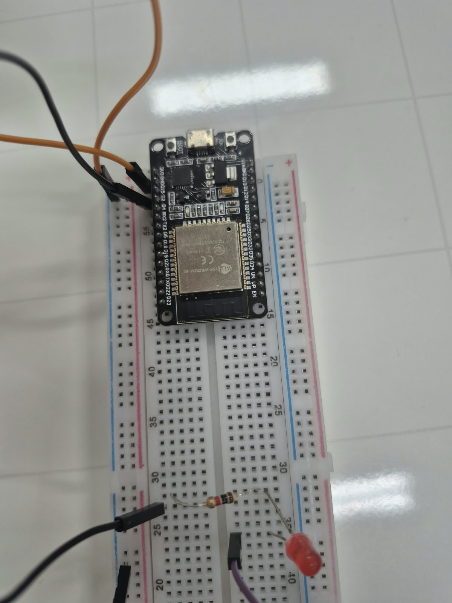

---

## 3. Problema

**Contexto.** Disciplinas de eletrônica dependem de instrumentos, como o multímetro, e de montagens em protoboard. O aluno costuma ter o primeiro contato com esses itens já na bancada.

**Situação atual.** A orientação vem do professor, que atende vários grupos ao mesmo tempo, ou de manuais e apostilas, que descrevem o equipamento de forma genérica e separada da peça real.

**Dificuldade.** O aluno precisa relacionar o que lê com o que vê: qual é o borne certo, em que posição fica o seletor, por onde passa a corrente num circuito. Erros de montagem e de medição são comuns nessa etapa.

**Público afetado.** Estudantes iniciantes em eletrônica e, indiretamente, os professores e técnicos que os acompanham.

**Impacto.** Tempo de aula gasto com dúvidas básicas, risco de danificar componentes e instrumentos e, em medições na rede elétrica, risco à segurança do aluno.

---

## 4. Objetivos

### 4.1 Objetivo Geral

Desenvolver um aplicativo Android de Realidade Aumentada que reconheça equipamentos e circuitos de laboratório e explique cada parte diretamente sobre a peça real.

### 4.2 Objetivos Técnicos

- Reconhecer imagens cadastradas com ARCore, por meio do ViroReact.
- Ancorar modelos 3D (`.glb`) em escala real sobre a peça reconhecida.
- Exibir pinos numerados e etiquetas 3D em cada parte.
- Permitir a seleção de uma parte para consultar sua explicação.
- Oferecer guias passo a passo com destaque visual da parte usada.
- Reconhecer um circuito montado a partir de uma peça rígida (ESP32), mesmo com fios em posições diferentes.
- Manter o conteúdo fixo na posição quando a imagem sai de vista.
- Executar e testar a aplicação em um celular Android real.

---

## 5. Público-Alvo

**Perfil:** estudantes de cursos técnicos e de graduação que estão começando em eletrônica.

**Contexto de uso:** laboratório ou bancada, com o equipamento ou o circuito à frente e o celular na mão.

**Necessidades:** identificar as partes de um instrumento, aprender a medir corretamente, entender um circuito e receber alertas de segurança no momento do uso.

**Familiaridade tecnológica:** basta saber usar um smartphone. O aplicativo não exige cadastro nem conhecimento prévio de Realidade Aumentada.

**Limitações:** é necessário um celular Android compatível com ARCore.

---

## 6. Funcionalidades

| ID | Funcionalidade | Descrição | Status |
|---|---|---|---|
| RF01 | Tela inicial | Escolha entre Equipamentos e Circuitos | ✅ |
| RF02 | Iniciar RA | Abre a câmera de RA com o catálogo da tela escolhida | ✅ |
| RF03 | Reconhecer multímetro | Reconhece a frente e a parte de trás do FT-266 | ✅ |
| RF04 | Reconhecer protoboard | Reconhece a imagem de demonstração da protoboard | ✅ |
| RF05 | Reconhecer circuito | Reconhece o circuito ESP32 + LED pela placa do ESP32, com três imagens de referência | ✅ |
| RF06 | Exibir modelo 3D | Mostra o modelo `.glb` sobre a peça reconhecida | ✅ |
| RF07 | Pinos e etiquetas 3D | Marca cada parte com um número e um nome | ✅ |
| RF08 | Explicar uma parte | Mostra o que é, como usar, dicas e cuidados | ✅ |
| RF09 | Guias passo a passo | Conduz o procedimento e destaca a parte de cada etapa | ✅ |
| RF10 | Alertas de segurança | Classifica os avisos em informação, atenção e perigo | ✅ |
| RF11 | Mostrar e ocultar | Alterna as etiquetas e o modelo 3D | ✅ |
| RF12 | Manter posição | Mantém o conteúdo no lugar quando a imagem sai de vista | ✅ |
| RF13 | Marcador impresso | Folha A4 com marcador para reconhecer o circuito de mais longe | ❌ |

**Legenda:** ✅ Implementado · 🚧 Em desenvolvimento · ⬜ Planejado · ❌ Cancelado

---

## 7. Requisitos Não Funcionais

| ID | Categoria | Requisito |
|---|---|---|
| RNF01 | Compatibilidade | Executar em Android compatível com ARCore, com o Google Play Services for AR instalado |
| RNF02 | Conectividade | Funcionar sem internet: alvos, modelos e textos ficam dentro do aplicativo |
| RNF03 | Usabilidade | Chegar à câmera de RA com um toque a partir da tela inicial |
| RNF04 | Usabilidade | Informar o estado do reconhecimento e orientar o usuário na própria tela |
| RNF05 | Desempenho | Evitar que o modelo pisque em perdas rápidas de rastreamento (tolerância de 800 ms) |
| RNF06 | Hardware | Exigir câmera traseira e sensores de movimento |
| RNF07 | Segurança | Não armazenar chaves ou dados pessoais; a câmera só é usada para o reconhecimento |

---

## 8. Tecnologias Utilizadas

| Tecnologia | Versão | Utilização |
|---|---|---|
| Expo | SDK 57 (57.0.23) | Plataforma de desenvolvimento e build |
| React Native | 0.86.3 | Interface e execução no Android |
| React | 19.2.3 | Componentes da interface |
| TypeScript | 6.0.3 | Linguagem do aplicativo |
| Expo Router | 57.0.29 | Navegação entre as telas |
| ViroReact (`@reactvision/react-viro`) | 2.57.3 | Cena 3D e integração com a RA |
| ARCore | fornecido pelo Google Play Services for AR | Reconhecimento e rastreamento de imagens no Android |
| Node.js | 22.12.0 | Ambiente de desenvolvimento |
| npm | 11.12.0 | Gerenciamento de pacotes |
| EAS CLI | 16 ou superior | Geração do APK na nuvem |
| Blender | 5.2 | Modelagem 3D (exportador glTF 5.2.40) |
| Python | 3.12.10 | Scripts que geram as imagens de referência |
| Pillow / NumPy | 12.3.0 / 2.5.2 | Tratamento das fotos nos scripts |
| Git | 2.51.2 | Controle de versão |
| GitHub | — | Hospedagem do código e da documentação |

---

## 9. Hardware Utilizado

| Equipamento | Modelo | Característica relevante | Utilização |
|---|---|---|---|
| Smartphone | Samsung Galaxy S25 Ultra | Android, compatível com ARCore | Execução e testes |
| Computador | Lenovo 82MG | Windows 11, Intel Core i5-11300H, 16 GB de RAM, NVIDIA GTX 1650 | Desenvolvimento |
| Multímetro | FT-266 | Instrumento real, frente e parte de trás | Objeto reconhecido |
| Placa de desenvolvimento | ESP32 DevKit (ESP-WROOM-32) | Placa rígida e com muitos detalhes | Referência visual do circuito |
| Protoboard | 830 furos | 165 × 55 mm | Montagem do circuito |
| Componentes | LED vermelho, resistor de 1 kΩ, 3 fios jumper | Circuito do pino D2 ao GND | Circuito de exemplo |

---

## 10. Arquitetura do Sistema

O aplicativo não possui servidor nem banco de dados. As telas escolhem um catálogo de conteúdo, a cena de RA registra os alvos desse catálogo e um estado compartilhado mantém a cena 3D e a interface 2D sincronizadas.

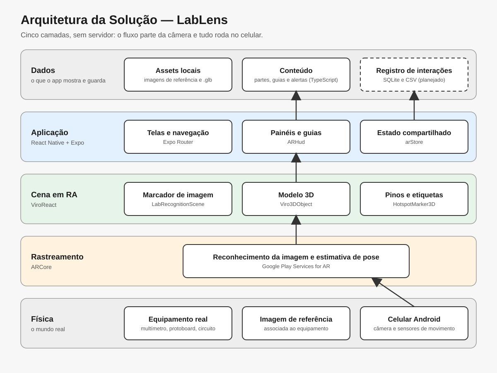

### Fluxo resumido

```text
Usuário
   ↓
Telas (Expo Router)
   ↓
ARView + ARHud
   ↓
LabRecognitionScene + catálogos de conteúdo
   ↓
ViroReact
   ↓
ARCore
   ↓
Câmera / Sensores
   ↓
Peça real no laboratório
```

---

## 11. Funcionamento da Realidade Aumentada

### 11.1 Técnica utilizada

O projeto usa **Image Tracking**: cada objeto possui uma ou mais imagens de referência (os "alvos"), fotografadas da própria peça. O ARCore procura essas imagens na câmera e calcula a posição e a orientação delas no espaço. O multímetro é reconhecido pela foto do painel, e o circuito pela placa do ESP32.

| Objeto | Imagem de referência | Largura real |
|---|---|---|
| Multímetro FT-266, frente | `assets/markers/ft266-frente.jpg` | 6,5 cm |
| Multímetro FT-266, parte de trás | `assets/markers/ft266-traseira.jpg` | 6,5 cm |
| Protoboard de demonstração | `assets/markers/protoboard-demo.png` | 16,5 cm |
| Circuito ESP32 + LED | `assets/markers/circuito-esp32-led.jpg`, `-2.jpg` e `-3.jpg` | 2,6 cm |

### 11.2 Fluxo técnico

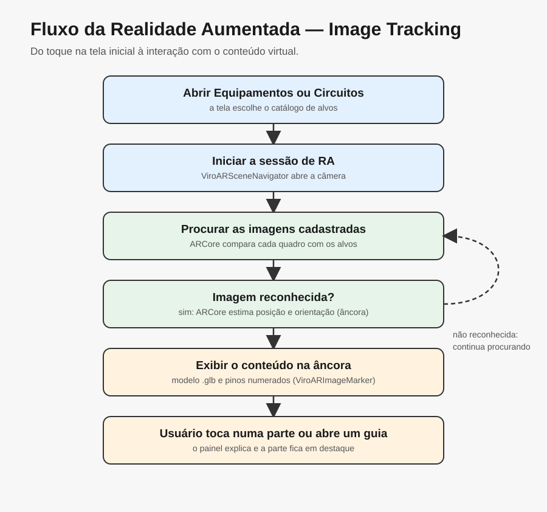

1. O usuário escolhe **Equipamentos** ou **Circuitos**, e `ARView` abre a sessão de RA com o catálogo correspondente.
2. `LabRecognitionScene` registra as imagens com `ViroARTrackingTargets`, informando a largura física de cada uma.
3. O ARCore compara os quadros da câmera com as imagens cadastradas.
4. Ao encontrar uma imagem, o `ViroARImageMarker` dispara `onAnchorFound`, e o `arStore` registra qual objeto e qual imagem estão ativos.
5. O modelo `.glb` e os pinos são desenhados como filhos do marcador, na posição do objeto real. As coordenadas são em metros, com origem no centro da imagem.
6. A cada atualização, `onAnchorUpdated` informa se a imagem está na câmera (`tracking`) ou fora de vista (`lastKnownPose`). Fora de vista, o conteúdo fica na última posição conhecida.
7. Ao tocar num pino ou abrir um guia, o `ARHud` mostra a explicação e a parte correspondente fica em destaque.

### 11.3 Elementos virtuais

- modelo 3D do objeto, em escala real;
- pinos numerados, com linha e etiqueta voltada para a câmera;
- destaque laranja da parte selecionada ou do passo atual;
- animação do botão Data Hold no modelo do multímetro;
- painéis 2D com explicações, guias e alertas de segurança;
- indicação do estado do reconhecimento.

### 11.4 Alinhamento do modelo com a peça real

Os modelos estão em escala real e são posicionados a partir de cálculos feitos sobre as fotos:

- `scripts/gerar-alvo-circuito-esp32.py` endireita a foto por uma homografia, calculada com furos e números impressos da protoboard;
- o mesmo script recorta só a placa do ESP32, que é rígida e cheia de detalhes;
- as fotos extras são alinhadas pelos 4 furos de fixação do ESP32, então as três imagens têm o mesmo enquadramento e usam as mesmas posições;
- o script imprime a transformação do modelo e a posição `(u, v)` de cada parte, usadas no arquivo de conteúdo.

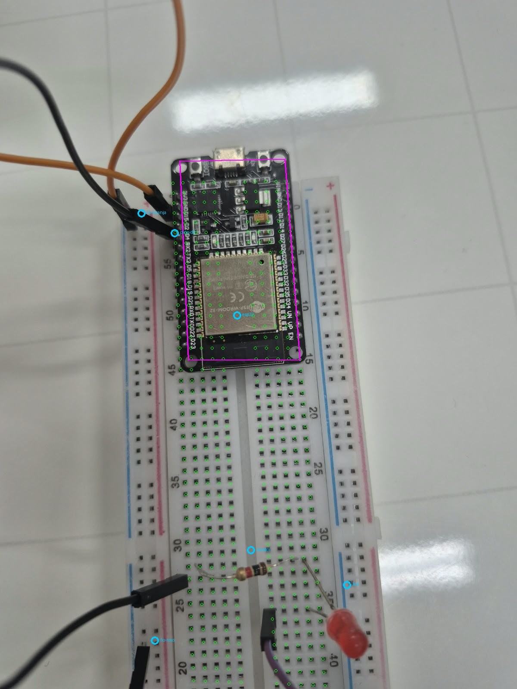

---

## 12. Estrutura do Projeto

```text
UPX8/
│
├── assets/
│   ├── images/               Ícones e tela de abertura
│   ├── markers/              Imagens de referência (alvos)
│   └── models/               Modelos 3D (.glb)
│
├── docs/
│   ├── diagrams/             Diagramas técnicos
│   ├── documents/            Guias complementares
│   └── images/               Capturas de tela e fotos de referência
│
├── scripts/                  Geração de alvos e modelos de demonstração
│
├── src/
│   ├── app/                  Telas (Expo Router)
│   ├── components/           Componentes de tema
│   ├── constants/            Cores e espaçamentos
│   ├── hooks/                Tema claro e escuro
│   └── features/lab-ar/      Realidade aumentada
│       ├── content/          Partes, guias e alertas de cada objeto
│       ├── scene/            Cena 3D, alvos e pinos
│       ├── ui/               Interface 2D sobre a câmera
│       ├── ARView.tsx        Sessão de RA de cada tela
│       ├── arStore.ts        Estado compartilhado
│       ├── geometry.ts       Posições e nomes dos alvos
│       └── types.ts          Tipos do conteúdo
│
├── app.json                  Configuração do Expo
├── eas.json                  Perfis de build
├── package.json              Dependências
└── README.md
```

### Pastas principais

| Pasta | Finalidade |
|---|---|
| `src/features/lab-ar/content` | Conteúdo didático: é onde se cadastra um objeto novo |
| `src/features/lab-ar/scene` | Reconhecimento das imagens e desenho do conteúdo 3D |
| `src/features/lab-ar/ui` | Status, painéis e guias sobre a câmera |
| `assets/markers` | Imagens que a câmera reconhece |
| `assets/models` | Modelos 3D em escala real |
| `scripts` | Scripts em Python que geram os alvos e as posições |
| `docs/documents` | Documentos complementares |

---

## 13. Principais Scripts

| Arquivo | Responsabilidade |
|---|---|
| `src/app/index.tsx` | Tela inicial, com a escolha entre Equipamentos e Circuitos |
| `src/app/ar.tsx`, `src/app/circuito.tsx` | Rotas que abrem a RA com cada catálogo |
| `src/features/lab-ar/ARView.tsx` | Inicia a sessão de RA e combina a câmera com a interface |
| `src/features/lab-ar/scene/LabRecognitionScene.tsx` | Registra os alvos, trata os eventos do ARCore e desenha o modelo e os pinos |
| `src/features/lab-ar/scene/HotspotMarker3D.tsx` | Desenha o pino, a linha e a etiqueta 3D |
| `src/features/lab-ar/ui/ARHud.tsx` | Mostra o status, os painéis de explicação e os guias |
| `src/features/lab-ar/arStore.ts` | Guarda o objeto reconhecido, a parte selecionada e o passo do guia |
| `src/features/lab-ar/geometry.ts` | Converte posições da imagem em posições 3D e nomeia os alvos |
| `src/features/lab-ar/content/index.ts` | Define os catálogos de Equipamentos e de Circuitos |
| `src/features/lab-ar/content/multimetro-ft266.ts` | Conteúdo do multímetro |
| `src/features/lab-ar/content/protoboard.ts` | Conteúdo da protoboard |
| `src/features/lab-ar/content/circuito-esp32-led.ts` | Conteúdo do circuito ESP32 + LED |
| `scripts/gerar-alvo-ft266.py` | Gera os alvos do multímetro e calcula as posições das partes |
| `scripts/gerar-alvo-circuito-esp32.py` | Gera os alvos do circuito e calcula as posições das partes |

### Como cadastrar um objeto novo

1. Modele o objeto em escala real, em metros, e exporte o `.glb` para `assets/models/`.
2. Tire uma foto bem de cima, com boa luz e sem reflexo, e salve em `docs/images/fotos/`.
3. Prefira uma área rígida e cheia de detalhes. Evite padrões repetitivos, como a grade de furos da protoboard.
4. Copie um script de `scripts/`, ajuste os pontos de calibração, o recorte e as partes, e rode o script.
5. Crie o conteúdo seguindo `multimetro-ft266.ts` ou `circuito-esp32-led.ts`, com os valores impressos pelo script.
6. Inclua o objeto em `EQUIPAMENTOS_AR` ou em `CIRCUITOS_AR`, no arquivo `content/index.ts`. A cena registra os alvos sozinha.
7. Para reconhecer o objeto em outras condições de luz, acrescente fotos do mesmo recorte em `alvo.imagensExtras`.

---

## 14. Dependências

As dependências ficam em `package.json`, e `npm install` instala todas elas. As essenciais para o funcionamento são:

```text
expo ~57.0.23
expo-router ~57.0.29
expo-dev-client ~57.0.19
react 19.2.3
react-native 0.86.3
react-native-reanimated 4.5.1
react-native-gesture-handler ~2.32.0
react-native-safe-area-context ~5.7.0
react-native-screens ~4.26.0
@reactvision/react-viro 2.57.3
```

| Biblioteca essencial | Onde obter |
|---|---|
| ViroReact | [github.com/ReactVision/viro](https://github.com/ReactVision/viro) |
| Expo | [docs.expo.dev/versions/v57.0.0](https://docs.expo.dev/versions/v57.0.0/) |
| Google Play Services for AR | [Lista de aparelhos compatíveis](https://developers.google.com/ar/devices) |

Os scripts de `scripts/` são opcionais e só são necessários para gerar alvos novos:

```bash
python -m pip install pillow numpy
```

---

## 15. Configuração do Ambiente

### Pré-requisitos

- Windows 10 ou 11;
- [Node.js](https://nodejs.org/) 22.13 ou superior, na linha 22 LTS (versões anteriores instalam, mas o Metro avisa que não são suportadas);
- [Git](https://git-scm.com/);
- conta gratuita no [Expo](https://expo.dev/signup), para gerar o APK;
- celular Android [compatível com ARCore](https://developers.google.com/ar/devices), com o Google Play Services for AR atualizado;
- Python 3.12, somente para gerar alvos novos.

> O ViroReact usa código nativo, então o projeto **não funciona no Expo Go**. É preciso instalar um *development build*, que é o APK do próprio aplicativo. O Android Studio não é necessário, porque o APK é gerado na nuvem.

### Procedimento

1. Instale o Node.js e o Git.
2. Clone o repositório e instale as dependências (seção 16).
3. Instale a ferramenta de build e entre na sua conta:

```bash
npm install --global eas-cli
```

```bash
eas login
```

4. Quem não faz parte do projeto no Expo deve apagar `extra.eas.projectId` do `app.json` e vincular a própria conta:

```bash
eas init
```

5. Gere o APK. O build roda na nuvem e leva de 10 a 25 minutos:

```bash
eas build --profile development --platform android
```

6. No final, o terminal mostra um link e um QR code. Abra-os no celular, baixe o APK e permita a instalação.

Só é preciso gerar outro APK quando mudarem as dependências nativas ou o `app.json`.

---

## 16. Como Executar

```bash
git clone https://github.com/EduardoBressan/UPX8.git
```

```bash
cd UPX8
```

```bash
npm install
```

```bash
npx expo start
```

Depois:

1. Deixe o celular e o computador na mesma rede Wi-Fi.
2. Abra no celular o aplicativo **LabLens** instalado na seção 15. Não use o Expo Go.
3. Toque no servidor que aparece na lista ou digite `http://SEU_IP:8081` e toque em **Connect**.
4. Para descobrir o IP, rode `ipconfig` e veja o "Endereço IPv4" da rede Wi-Fi.
5. Se não conectar, libere o Node.js no firewall do Windows ou use `npx expo start --tunnel`.

Para gerar um APK que funciona sem o computador ligado:

```bash
eas build --profile preview --platform android
```

---

## 17. Como Utilizar a Aplicação

### Equipamentos

1. Abra o aplicativo e toque em **Equipamentos**.
2. Autorize o acesso à câmera.
3. Deite o multímetro na mesa, com o painel para cima e o **seletor em OFF**.
4. Aponte o celular para o painel, a cerca de 30 cm, e mova devagar.
5. Quando o modelo 3D aparecer, toque nos números para ver cada parte.
6. Abra um guia, como **Medir tensão contínua (DC)**, e siga os passos.
7. Vire o multímetro para ver a parte de trás e o guia **Trocar a bateria**.

### Circuitos

1. Toque em **Circuitos**.
2. Aproxime o celular do ESP32, de cima, até a placa ocupar cerca de metade da tela.
3. Mantenha boa luz e evite fios por cima do ESP32 e reflexo no módulo prateado.
4. Quando o modelo aparecer, você pode afastar o celular: ele fica preso na posição.
5. Toque nos números ou abra um guia, como **Seguir o caminho da corrente**.

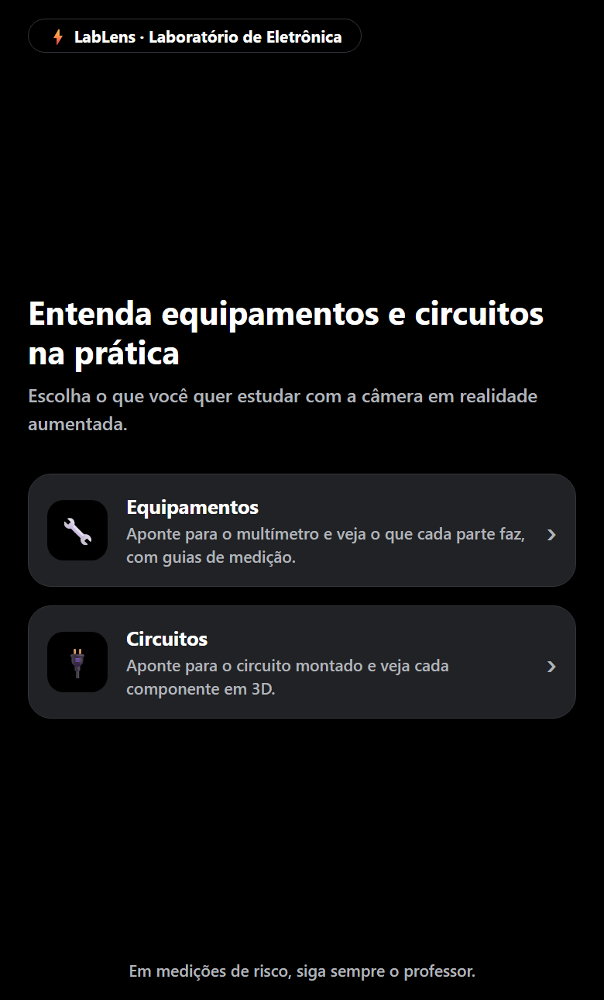

---

## 18. Fluxo de Funcionamento

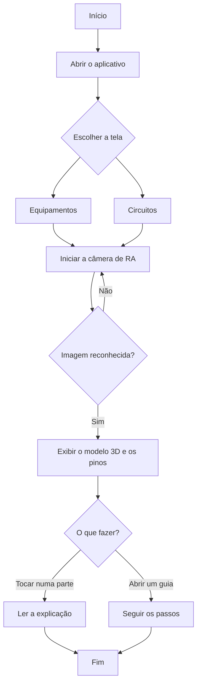

---

## 19. Caso de Uso

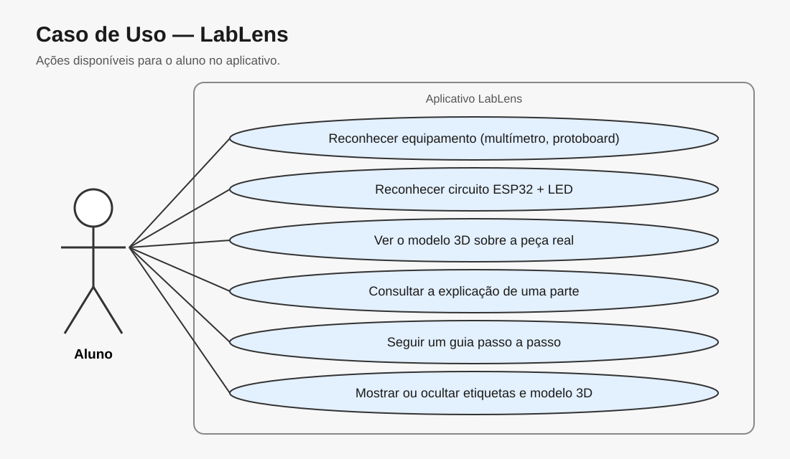

---

## 20. Fluxo de Navegação

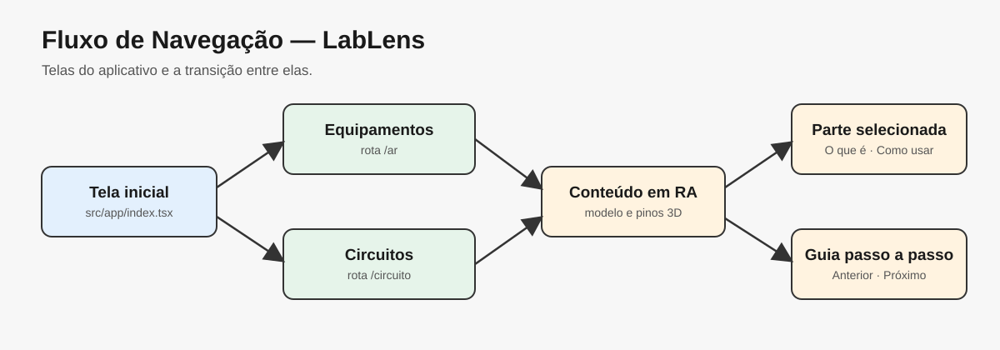

---

## 21. Interface

### Tela inicial


- **Finalidade:** escolher o que estudar.
- **Elementos:** cartões **Equipamentos** e **Circuitos** e aviso de segurança.
- **Ação do usuário:** tocar em um dos cartões.
- **Observação:** imagem capturada na versão web da mesma tela.

### Câmera de RA em Circuitos

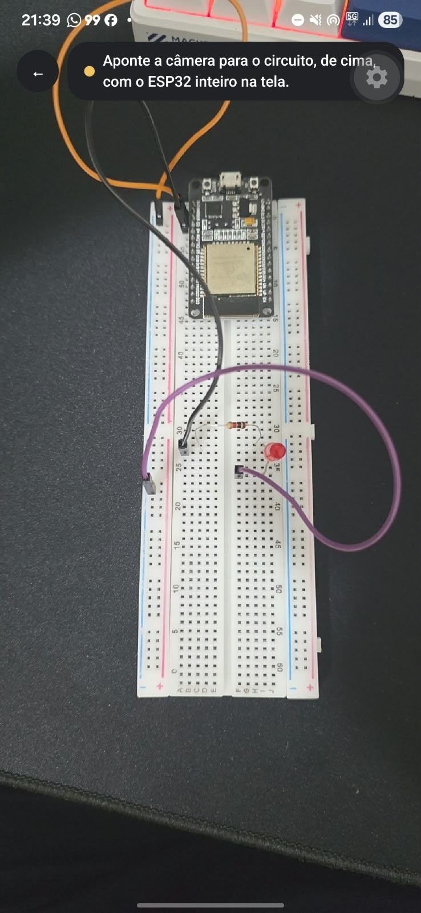

- **Finalidade:** reconhecer o circuito.
- **Elementos:** botão de voltar, indicador de estado e orientação para o usuário.
- **Ação do usuário:** aproximar o celular do ESP32. Nesta captura, o circuito ainda não foi reconhecido porque está longe da câmera.

### Multímetro reconhecido

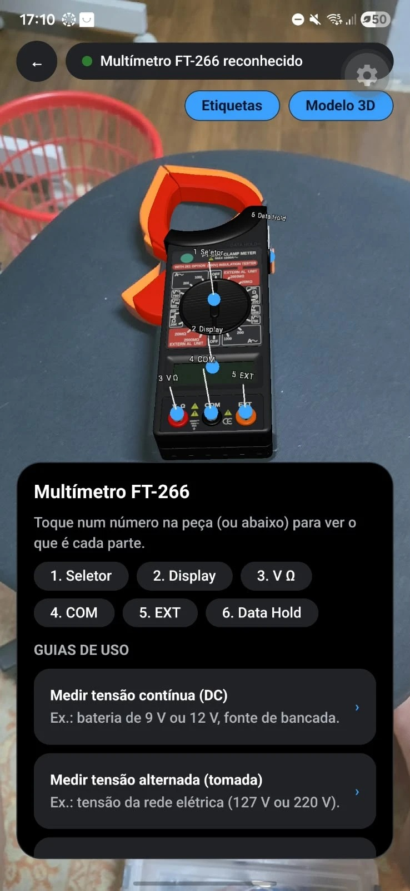

- **Finalidade:** explicar o multímetro sobre a peça real.
- **Elementos:** indicador verde de reconhecimento, botões **Etiquetas** e **Modelo 3D**, modelo 3D com pinos numerados e painel com as partes e os guias de uso.
- **Ação do usuário:** tocar num número ou abrir um guia.

### Circuito reconhecido

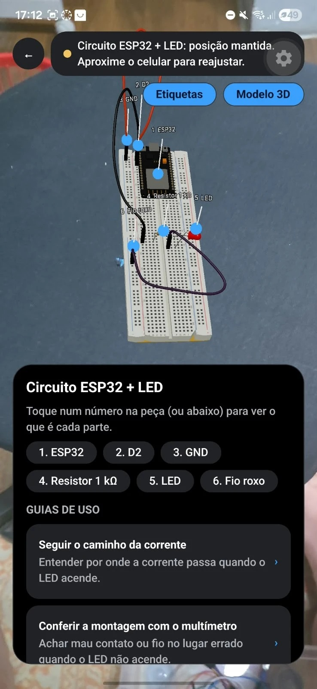

- **Finalidade:** explicar o circuito ESP32 + LED.
- **Elementos:** modelo 3D do circuito, pinos numerados e painel com as partes e os guias. O indicador amarelo mostra que o conteúdo está na última posição conhecida, porque o celular se afastou do ESP32.
- **Ação do usuário:** tocar num número ou abrir um guia, como **Seguir o caminho da corrente**.

---

## 22. Testes Técnicos

| Teste | Procedimento | Resultado esperado | Resultado obtido | Status |
|---|---|---|---|---|
| Tipos | `npx tsc --noEmit` | Nenhum erro | Nenhum erro | ✅ |
| Lint | `npx expo lint` | Nenhum erro | Nenhum erro | ✅ |
| Instalação limpa | Clonar o repositório, rodar `npm ci` e `npx expo start` e verificar os tipos | Dependências instalam e o código compila | Instalou e compilou | ✅ |
| Scripts dos alvos | Rodar os scripts de `scripts/` | Geram imagens idênticas às do projeto | Imagens idênticas | ✅ |
| Multímetro | Apontar a câmera para o FT-266 | Reconhecer e exibir o modelo 3D | Reconheceu e exibiu | ✅ |
| Guia passo a passo | Abrir **Medir tensão contínua (DC)** com o multímetro reconhecido | Avançar os passos com a parte em destaque | Passos e destaques funcionaram | ✅ |
| Circuito: alvo com a protoboard | Usar um alvo com protoboard, fios e mesa | Reconhecer e exibir o modelo 3D | Exibiu uma vez e não repetiu | ❌ |
| Circuito: alvo só com o ESP32 | Aproximar o celular do ESP32 | Reconhecer e exibir o modelo 3D | Reconheceu e exibiu, mas exige aproximação | ✅ |
| Manter posição | Afastar o celular depois do reconhecimento | Conteúdo continua no lugar | Conteúdo mantido, com aviso na tela | ✅ |

---

## 23. Dispositivos Testados

| Dispositivo | Sistema | Resultado |
|---|---|---|
| Samsung Galaxy S25 Ultra | Android | Compatível: reconheceu o multímetro e o circuito |

---

## 24. Limitações Conhecidas

- O circuito só é reconhecido de perto, porque a placa do ESP32 tem 2,6 cm de largura na imagem de referência.
- O conteúdo do circuito vale para esta montagem: se os fios estiverem em outros furos, o 3D não coincide com a placa real.
- No modelo do circuito, o resistor e o LED ficam cerca de 4 mm deslocados em relação à montagem real, e o ESP32 é um pouco menor que a placa real.
- Fios sobre o ESP32, pouca luz e reflexo no módulo prateado dificultam o reconhecimento.
- As imagens de referência do circuito vêm de fotos de resolução limitada.
- Protoboards reais são difíceis de reconhecer, porque a grade de furos é um padrão repetitivo.
- No multímetro, o seletor faz parte da imagem reconhecida e deve estar em OFF.
- Só é reconhecido o que está cadastrado em `src/features/lab-ar/content/`.
- A posição do conteúdo depende de a largura física do alvo estar correta.
- Depois que a imagem sai de vista, o conteúdo fica na última posição conhecida: se a peça for movida, ele não acompanha.
- O projeto está configurado e testado apenas no Android, e não funciona no Expo Go nem no navegador.

---

## 25. Evidências de Funcionamento

- **Aplicativo em execução:** veja as capturas da seção 21.
- **Imagens de referência:** o circuito é reconhecido pelas três imagens abaixo.

| Mesa clara | Mesa escura, de perto | Mesa escura, de cima |
|---|---|---|
| 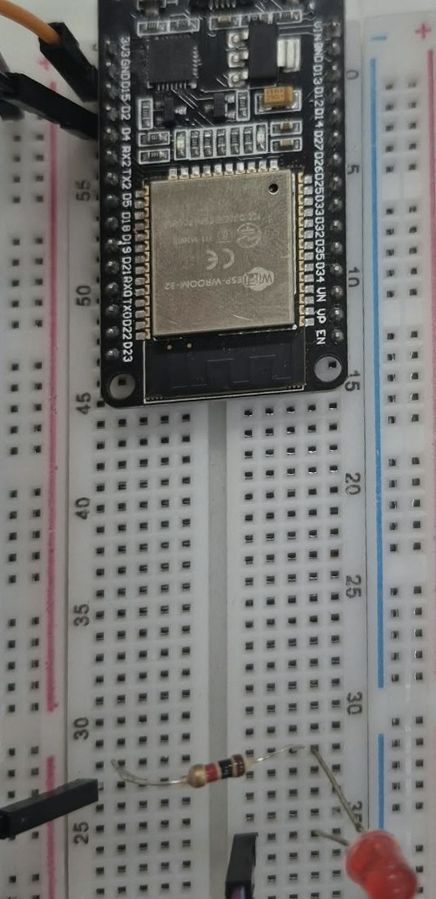 | 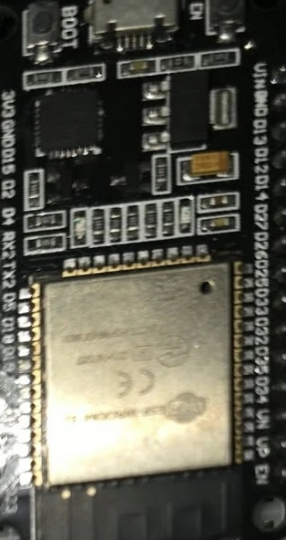 | 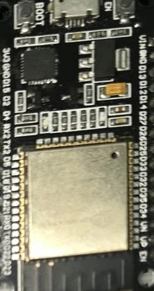 |

- **Experiência de RA:** o multímetro e o circuito reconhecidos, com o modelo 3D na tela.

| Multímetro FT-266 | Circuito ESP32 + LED |
|---|---|
|  |  |

- **Vídeo:** [assistir à demonstração do multímetro](docs/images/demonstracao-multimetro.mp4), com o reconhecimento e um guia de medição.

---

## 26. Repositórios e Recursos

| Recurso | Link |
|---|---|
| Código-fonte | [github.com/EduardoBressan/UPX8](https://github.com/EduardoBressan/UPX8) |
| Modelo da documentação | [github.com/dr-ohata/upx-modelo](https://github.com/dr-ohata/upx-modelo) |
| Vídeo | [Demonstração do multímetro](docs/images/demonstracao-multimetro.mp4) |

---

## 27. Cronograma Técnico

| Atividade | Responsável | Status |
|---|---|---|
| Configuração do projeto Expo | Equipe | ✅ |
| Reconhecimento de imagem com ViroReact | Equipe | ✅ |
| Modelo 3D e alvos do multímetro | Equipe | ✅ |
| Interface, pinos e guias | Equipe | ✅ |
| Modelo 3D do circuito ESP32 + LED | Equipe | ✅ |
| Reconhecimento do circuito | Equipe | ✅ |
| Melhoria da distância de reconhecimento | Equipe | 🚧 |
| Testes em dispositivo | Equipe | 🚧 |
| Documentação | Equipe | 🚧 |

---

## 28. Controle de Versão

O desenvolvimento está registrado em commits na branch `main`. A parte de circuitos foi feita na branch `circuitos` e integrada pelo Pull Request #1.

| Commit | Alteração |
|---|---|
| `2b7f43b` | Realidade aumentada com reconhecimento de imagem e modelos 3D |
| `b40042b` | Modelo 3D do multímetro e ajuste da RA para esse modelo |
| `ab8078a` | Reconhecimento dos circuitos |
| `22bdb5d` | Melhorias na interface e no reconhecimento do circuito |
| `481e513` | Três imagens de referência para o circuito |

Daqui em diante, as mensagens seguem o padrão abaixo:

```text
feat: adiciona novo circuito ao catálogo
fix: corrige posição do modelo 3D
docs: atualiza instruções de execução
test: registra teste em dispositivo Android
```

---

## 29. Problemas Encontrados e Soluções

### Problema 1 — Modelo do circuito quase nunca aparecia

**Problema:** o modelo 3D do circuito apareceu uma vez e não voltou a aparecer.  
**Causa:** a imagem de referência era quase toda grade de furos, um padrão repetitivo, e incluía fios e mesa, que mudam de uma montagem para outra.  
**Solução:** recortar a imagem só na placa do ESP32, que é rígida e cheia de detalhes.

### Problema 2 — Reconhecimento difícil com pouca luz

**Problema:** em mesa escura e com pouca luz, o circuito continuava difícil de reconhecer.  
**Causa:** havia uma única imagem de referência, feita em mesa clara e com luz forte.  
**Solução:** cadastrar o mesmo recorte a partir de três fotos, alinhadas pelos 4 furos de fixação do ESP32.

### Problema 3 — Risco de conteúdo duplicado com várias imagens

**Problema:** com várias imagens do mesmo circuito, o modelo poderia aparecer duplicado e um guia aberto poderia reiniciar.  
**Causa:** cada imagem reconhecida gera um marcador próprio.  
**Solução:** o `arStore` guarda a imagem ativa, e o conteúdo só troca de imagem quando a atual sai de vista.

### Problema 4 — Parte de trás do multímetro não era reconhecida

**Problema:** o app não reconhecia a parte de trás enquanto ainda guardava a frente.  
**Causa:** o ARCore rastreava menos imagens ao mesmo tempo do que as cadastradas.  
**Solução:** definir `numberOfTrackedImages` com o número total de imagens do catálogo.

### Problema 5 — Modelo piscava com a câmera em movimento

**Problema:** o conteúdo sumia e voltava quando a câmera tremia ou inclinava.  
**Causa:** o ARCore perde a imagem por instantes durante esses movimentos.  
**Solução:** manter o conteúdo na última posição conhecida e aplicar uma tolerância de 800 ms antes de considerar o objeto fora de vista.

### Problema 6 — Erro de plugin ao trocar de branch

**Problema:** `npx expo start` falhava com `Failed to resolve plugin for module "expo-camera"`.  
**Causa:** o `git checkout` trocou os arquivos do projeto, mas a pasta `node_modules` continuava com as dependências de outra branch.  
**Solução:** voltar à branch correta ou rodar `npm install` depois de trocar de branch.

---

## 30. Melhorias Futuras

- Refazer as imagens de referência com fotos de maior resolução.
- Aumentar a distância de reconhecimento do circuito.
- Ajustar o modelo 3D do circuito para coincidir com a montagem real.
- Cadastrar novos equipamentos e circuitos.
- Adicionar suporte a iOS.

---

## 31. Custos e Recursos

| Recurso | Tipo | Custo/Condição |
|---|---|---|
| Expo e EAS Build | Software | Plano gratuito |
| ViroReact | Software | Código aberto |
| Blender | Software | Gratuito |
| Python, Pillow e NumPy | Software | Gratuitos |
| GitHub | Serviço | Plano gratuito |
| Smartphone e computador | Hardware | Equipamentos da equipe |
| Multímetro, ESP32, protoboard e componentes | Hardware | Equipamentos de integrantes da equipe |

---

## 32. Licença

Projeto acadêmico desenvolvido para fins educacionais na disciplina de UPX8 — Realidade Aumentada.

O arquivo `LICENSE` é a licença MIT do template inicial do Expo, usado como base do projeto.

---

## 33. Autores

**Equipe VantageAR — turma TIN2**

- **Eduardo Bressan Paixão** — Requisitos, dataset, anotação de imagens e desenvolvimento
- **Felipe Rondello A. Lopes** — Pesquisa e documentação
- **João Guilherme Borges Feliciano** — UI/UX e análise de dados
- **Lucas Vinícius Tomé** — Modelo de visão computacional
- **Luiza Santos Mascarenhas Bottesi** — Gerência de projeto e desenvolvimento mobile
- **William Rocchi Dias** — Testes e experimento com usuários

**Instituição:** UniFacens  
**Disciplina:** UPX8 — Realidade Aumentada  
**Semestre:** 2026.2

Estrutura de realidade aumentada baseada nos templates **WL01 Recognition AR** e **WL02 Spatial AR** fornecidos pelo professor.

---

## Checklist de Entrega

- [x] Código-fonte atualizado
- [x] README completamente preenchido
- [x] Versões das tecnologias registradas
- [x] Arquitetura apresentada
- [x] Funcionamento da RA explicado
- [x] Estrutura de pastas documentada
- [x] Scripts principais descritos
- [x] Procedimento de instalação testado
- [x] Procedimento de execução testado
- [x] Screenshots reais adicionados
- [x] Testes registrados
- [x] Dispositivos testados informados
- [x] Limitações conhecidas documentadas
- [x] Evidência de funcionamento adicionada
- [x] Commits representam a evolução do projeto
